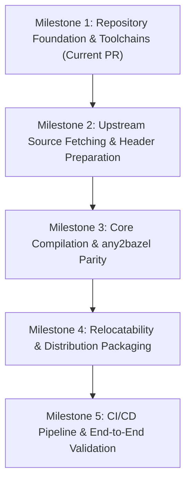

# Action Plan: Building Upstream Relocatable Perl from Source with Bazel

## 1. Executive Summary & Objective

The objective of this project is to build upstream latest tagged Perl from source using Bazel, producing self-contained, relocatable binaries and runtime archives for consumption by [`rules_perl`](https://github.com/bazel-contrib/rules_perl).

All builds will be performed from a single host platform (Linux x86_64) targeting four primary platforms (`linux_amd64`, `linux_arm64`, `osx_amd64`, and `osx_arm64`) using the hermetic LLVM toolchain and remote build execution (RBE) via BuildBuddy. The build will strictly follow the relocatability conventions established by `perl-relocatable` (`skaji/relocatable-perl`), verify build action equivalence against upstream builds using `any2bazel`, and automate verification and release distribution through GitHub Actions.

---

## 2. Boundaries & Requirements

| Requirement | Boundary Definition | Implementation Strategy |
|---|---|---|
| **Relocatability** | Follow `perl-relocatable` | Compile with `-Duserelocatableinc`, patch `Config_heavy.pl` and `Config.pm` for relative runtime `@INC` (`.../perl`, `.../../bin`), and rewrite script shebangs. |
| **Upstream Source** | Fetch from `https://www.cpan.org/src/5.0` | Implement Bzlmod module extension fetching `perl-<version>.tar.gz` directly from CPAN, applying patches from `bazel/patches/perl/`. |
| **Bazel Version** | Latest available released Bazel | Pin to Bazel `9.3.2` via `.bazelversion`, utilizing Bzlmod and modern Starlark rules. |
| **C/C++ Toolchain** | Hermetic LLVM without building from source | Use BCR module `llvm` (`0.8.27`) registering `@llvm//toolchain:all` and `@llvm//extensions:osx.bzl` frameworks. |
| **Single-Platform Build** | Cross-compile from 1 platform to Linux/macOS (amd64/arm64) | Single Linux x86_64 host/RBE runner cross-compiles all 4 target triples using LLVM sysroot/glibc constraints and Darwin SDK. |
| **Patches** | Patches located in `bazel/patches/perl/` | Store unified diffs under `bazel/patches/perl/` and apply them in the source module extension with `-p1`. |
| **Migration & Parity** | `any2bazel` parity verification | Extract canonical action models from upstream reference builds and Bazel `aquery`, tuning `any2bazel.json` until convergence. |
| **RBE Integration** | `toolchains_buildbuddy` ruleset initialized | Declare `toolchains_buildbuddy` (`0.0.4`) with container `docker://gcr.io/flame-public/rbe-ubuntu24-04`. |
| **Cluster Execution** | Assume `--config=rbe` enables building with cluster | Configure `--config=rbe` profile in `.bazelrc` and generate `.bazelrc.user` via `tools/setup_buildbuddy.sh`. |
| **GitHub Actions CI/CD** | PR action for 5.45.4; Tag action for `v5.44.0+` (`v5.44.0.1`) | `ci.yml` builds Perl 5.45.4 on PRs using RBE; `release.yml` triggers on `v5.*` tags, builds all 4 platforms, and publishes GitHub Release assets with checksums. |

---

## 3. Architecture & Technical Design

### 3.1 Bazel Workspace & Bzlmod Setup
- **`.bazelversion`**: Set to `9.3.2`.
- **`.bazelrc`**: Configured with strict action environments (`--incompatible_strict_action_env`), Bzlmod (`--enable_bzlmod`, `--lockfile_mode=update`), target platform profiles (`--config=linux_amd64`, `--config=linux_arm64`, `--config=osx_amd64`, `--config=osx_arm64`), RBE profile (`--config=rbe`), and `try-import %workspace%/.bazelrc.user`.
- **`MODULE.bazel`**:
  - `platforms` (`1.1.0`), `platforms_contrib` (`1.0.0-alpha.0`), `bazel_skylib` (`1.9.2`)
  - `rules_cc` (`0.2.28`), `rules_shell` (`0.10.0`), `tar.bzl` (`0.10.9`)
  - `llvm` (`0.8.27`) with Darwin SDK extension
  - `toolchains_buildbuddy` (`0.0.4`)

### 3.2 Platforms & Cross-Compilation
Target platforms are defined in `bazel/BUILD.bazel`:
1. `//bazel:linux_amd64`: `@platforms//os:linux`, `@platforms//cpu:x86_64`, `@llvm//constraints/libc:gnu.2.28`
2. `//bazel:linux_arm64`: `@platforms//os:linux`, `@platforms//cpu:aarch64`, `@llvm//constraints/libc:gnu.2.28`
3. `//bazel:osx_amd64`: `@platforms//os:macos`, `@platforms//cpu:x86_64`
4. `//bazel:osx_arm64`: `@platforms//os:macos`, `@platforms//cpu:aarch64`
5. `//bazel:ubuntu24_04_amd64`: RBE execution platform targeting Ubuntu 24.04 container.

### 3.3 Hermetic LLVM Toolchain
Prebuilt Clang and libc++ toolchains from `@llvm//toolchain:all` eliminate the need to compile LLVM from source. Target sysroots and glibc stubs are provided hermetically:
- Linux targets link against glibc 2.28 headers/stubs (compatible with RHEL 8+, Debian 10+, Ubuntu 20.04+).
- macOS targets utilize `@llvm//extensions:osx.bzl` to link system frameworks (`CoreFoundation`, `Foundation`, `Security`, `SystemConfiguration`).

### 3.4 Upstream Source & Configuration Mechanics
Upstream Perl relies on `./Configure` to probe system headers and write `config.sh` and `config.h`. In a hermetic Bazel build:
- Tarballs are fetched via `perl_dist` extension from `https://www.cpan.org/src/5.0/perl-<version>.tar.gz`.
- Platform-specific `config.h` and `config.sh` headers will be prepared for the four target architectures (glibc 2.28 for Linux, macOS SDK for Darwin) and injected into the compilation quote include paths.
- Necessary core patches (e.g. for musl/glibc portability or relocatability) are stored in `bazel/patches/perl/`.

### 3.5 Relocatability Implementation (`perl-relocatable`)
Following `skaji/relocatable-perl`:
1. **Compilation Flags**: `-Duserelocatableinc` enables relative path lookups in the interpreter binary.
2. **Post-Processing Configuration**:
   - `Config_heavy.pl`: Update `installbin='.../../bin'`, `installprefix='.../..'`, `perlpath='.../perl'`, `startperl='#!.../perl'`, and wrap entries in `relocate_inc(...)`.
   - `Config.pm`: Adjust `libdir` and `scriptdir` evaluation to use `relocate_inc('.../')`.
3. **Shebangs**: Rewrite bundled executable scripts (in `bin/`) to use portable relative invocations or `#!/usr/bin/env perl`.
4. **Binary Structure**:
   ```
   perl-<version>-<platform>/
   ├── bin/
   │   ├── perl
   │   ├── perl<version> -> perl
   │   ├── cpan
   │   └── perldoc
   └── lib/
       ├── 5.45.4/
       │   ├── Config.pm
       │   ├── Config_heavy.pl
       │   └── ...
       └── ...
   ```

### 3.6 Migration & Parity Verification (`any2bazel`)
Parity with upstream Perl compilation is established via the `any2bazel` workflow:
1. **Extract Reference Actions**: Capture upstream compile and link commands into `model.reference.json`.
2. **Extract Bazel Actions**: Run `bazel aquery` on `@perl//...` and extract into `model.bazel.json` using `extract_bazel.py`.
3. **Diff & Triage**: Run `diff.py` to compare compiler definitions, flags, and include paths across all translation units.
4. **Convergence**: Manage acceptable cosmetic differences in `any2bazel.json` until zero error discrepancies remain (`converged: true`).

### 3.7 Remote Build Execution (RBE)
- `toolchains_buildbuddy` establishes execution container metadata.
- `.bazelrc` defines `--config=rbe` execution parameters (remote spawn strategy, chunking, jobs, and minimal output downloads).
- `tools/setup_buildbuddy.sh` dynamically generates `.bazelrc.user` using `BB_ENDPOINT` (or `BUILDBUDDY_ENDPOINT`) and `BB_API_KEY` (or `BUILDBUDDY_API_KEY`).

### 3.8 CI/CD Workflows
- **PR Workflow (`.github/workflows/ci.yml`)**:
  - Triggers on PRs to `main`.
  - Configures BuildBuddy RBE credentials.
  - Builds Perl 5.45.4 across all target platforms with `--config=rbe`.
- **Release Workflow (`.github/workflows/release.yml`)**:
  - Triggers on version tags `v5.*` (e.g., `v5.44.0.1`, `v5.45.4.1`).
  - Extracts upstream Perl version and package revision.
  - Builds all target archives on RBE.
  - Computes `SHA256SUMS`.
  - Creates GitHub Release and publishes release assets (`.tar.gz`, `.tar.xz`, `SHA256SUMS`).

---

## 4. Phased Implementation Roadmap



### Milestone 1: Repository Foundation & Toolchains ([#3](https://github.com/manuelnaranjo/bazelify-perl/issues/3))
- [x] Configure Bazel `9.3.2` via `.bazelversion`.
- [x] Create `.bazelrc` with platform flags, hermeticity flags, and RBE profile.
- [x] Initialize `MODULE.bazel` with `llvm`, `toolchains_buildbuddy`, `platforms`, `platforms_contrib`, `rules_cc`, `rules_shell`, `tar.bzl`.
- [x] Define target platforms (`linux_amd64`, `linux_arm64`, `osx_amd64`, `osx_arm64`) and RBE platform (`ubuntu24_04_amd64`).
- [x] Implement `tools/setup_buildbuddy.sh` credential generator.
- [x] Create GitHub Actions workflows for PR (`ci.yml`) and Releases (`release.yml`).
- [x] Establish `AGENTS.md` and repository guidelines.
- [x] Write `docs/plan.md`.

### Milestone 2: Upstream Source Fetching & Header Preparation ([#4](https://github.com/manuelnaranjo/bazelify-perl/issues/4))
- [x] Implement `bazel/extensions.bzl` (`perl_dist` module extension) to download tarballs from `https://www.cpan.org/src/5.0/`.
- [x] Setup patch application mechanism pointing to `bazel/patches/perl/`.
- [x] Capture and stage hermetic `config.h` and `config.sh` for Linux (glibc 2.28) and macOS SDK.
- [x] Implement opcode/keyword regeneration or pre-staged generated C sources (`keywords.c`, `opcode.h`, `regnodes.h`).

### Milestone 3: Core Compilation & any2bazel Parity ([#5](https://github.com/manuelnaranjo/bazelify-perl/issues/5))
- [x] Create `bazel/perl/perl.BUILD.bazel` overlay defining `cc_library` / `cc_binary` for `miniperl`, `libperl`, and `perl`.
- [x] Build core extensions and shared objects (POSIX, Socket, IO, Fcntl, etc.).
- [x] Run reference build in container and extract `model.reference.json`.
- [x] Run `bazel aquery` and extract `model.bazel.json`.
- [x] Diff and converge translation units in `any2bazel.json`.

### Milestone 4: Relocatability & Distribution Packaging ([#6](https://github.com/manuelnaranjo/bazelify-perl/issues/6))
- [x] Implement post-build Starlark rule / script to patch `Config_heavy.pl` and `Config.pm` with relative paths.
- [x] Implement shebang rewriting tool (`change-shebang`).
- [x] Assemble `tar.bzl` distribution archives matching `rules_perl` naming:
  `perl-<version>-<platform>.tar.gz` and `perl-<version>-<platform>.tar.xz`.
- [x] Verify runtime execution of unpacked binaries in clean environments.

### Milestone 5: CI/CD Pipeline & End-to-End Validation ([#7](https://github.com/manuelnaranjo/bazelify-perl/issues/7))
- [ ] Run PR build workflow for Perl 5.45.4 with live BuildBuddy RBE credentials.
- [ ] Test tag release pipeline on simulated tag `v5.45.4.1`.
- [ ] Set up e2e smoke test verifying consumption by `rules_perl`.

---

## 5. Verification & Acceptance Criteria

1. **Parity**: `any2bazel` reports `converged: true` with 0 error discrepancies.
2. **Hermeticity**: Builds succeed without accessing host headers or undeclared tools.
3. **Multi-Platform**: All 4 target platforms build from a single Linux x86_64 host.
4. **Relocatability**: Unpacked tarball can be moved to an arbitrary directory path and successfully run scripts and resolve `@INC` without errors.
5. **CI/CD**: PR workflow builds Perl 5.45.4 on RBE; release workflow successfully triggers on `v5.*` tags and produces release assets.
